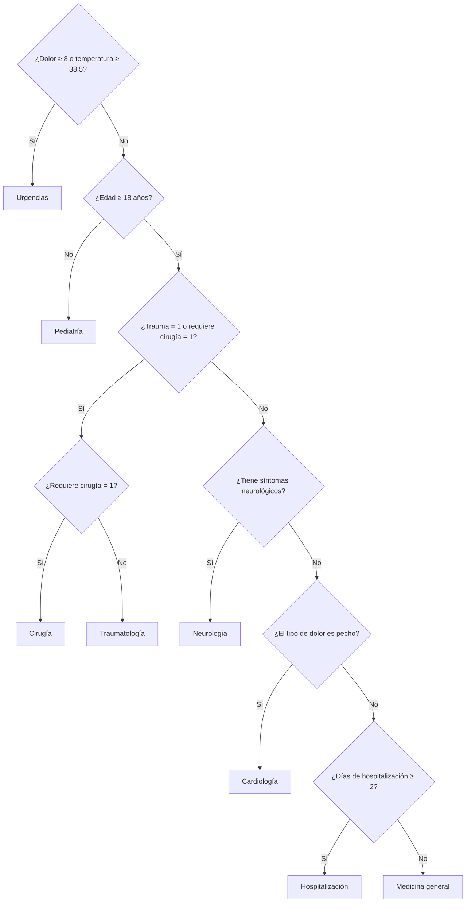

# Taller-2-EdD

- Nombre: Tomás Johao Sabando Jofré
- RUT: 22.368.978-7
- Carrera: ITI
- Username: 0xbadcoded
- Paralelo: C2

## Compilar
g++ -I.h .cpp/ArbolAVL.cpp .cpp/ArbolDecision.cpp .cpp/Main.cpp .cpp/Sistema.cpp -o taller2

./taller2

## Jerarquía del árbol de decisiones.
El árbol evalúa primero los criterios de urgencia. Si el paciente no cumple ese criterio, continúa con la edad y las demás características:

Se eligió este orden para evaluar primero los criterios de urgencia y luego derivar al paciente según su edad y características. Por eso, si cumple el criterio de urgencia, se asigna a Urgencias antes de evaluar las demás preguntas.
